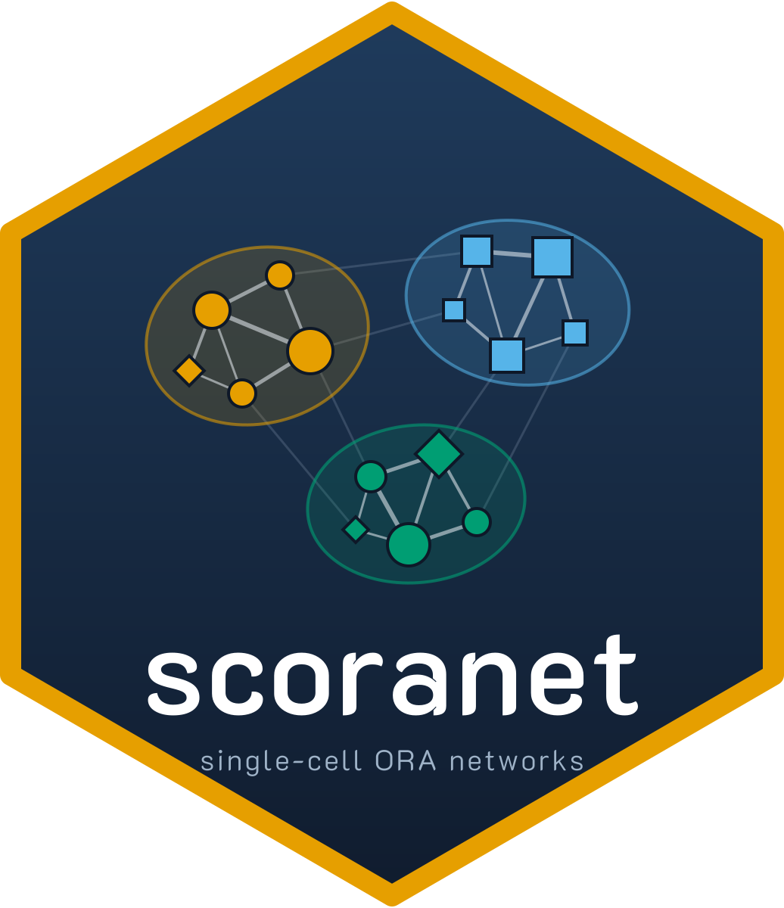

# scoranet 

**Single-cell differential expression, GO over-representation analysis, and pathway overlap networks.** Developed by the Mike Martinez

 
 [](https://dartmouth-data-analytics-core.github.io/GDSCtools/index.html)
 
 [](https://codecov.io/gh/dartmouth-data-analytics-core/GDSCtools)

> [!WARNING]
> **🚧 In development:**


## Installation

```r
# Install from github
devtools::install_github("https://github.com/mikemartinez99/scoranet/")
```

## Dependencies

Install Bioconductor dependencies first if needed:

```r
if (!requireNamespace("BiocManager", quietly = TRUE))
    install.packages("BiocManager")
BiocManager::install(c("clusterProfiler", "org.Mm.eg.db"))
```


## License

MIT
