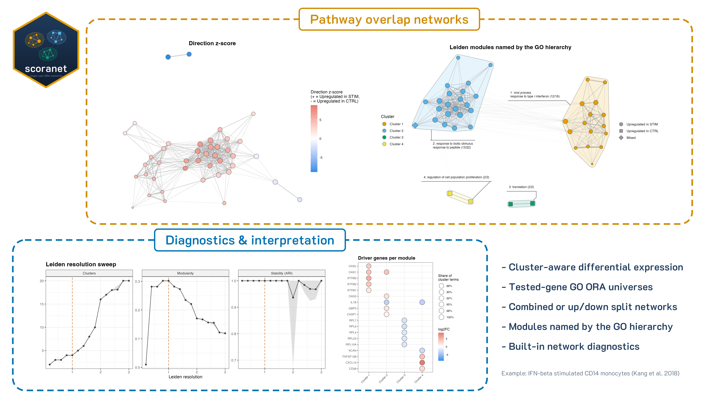

# Single-Cell Over-Representation Analysis NETworks (scoranet)

*Identify themes in your single cell functional enrichment results in a clean, interpretable way!*

 <!-- badges: start -->
 
 
 [](https://mikemartinez99.github.io/scoranet/)
 
 [](https://github.com/mikemartinez99/scoranet/actions/workflows/R-CMD-check.yaml)
 [](https://app.codecov.io/gh/mikemartinez99/scoranet)

 <!-- badges: end -->

---



## Installation

Install the latest version from Github via `devtools`

```r
install.packages("devtools")
library(devtools)

devtools::install_github("mikemartinez99/scoranet")

library(scoranet)
```

## Overview
Single-cell experiments often produce hundreds of differentially expressed genes per cell type, and gene ontology (GO) over-representation analysis on those genes can return dozens of overlapping, redundant terms. **scoranet** (Single-Cell Over-Representation Analysis NETworks) turns that list into a map of biological programs to help make sense of your results. Outputs are fully editable `ggplot2` objects.

> [!IMPORTANT]
> **scoranet is compatible with Seurat v4 and v5!**

For each cell type, scoranet:

1. **Tests for differential expression** between two conditions within each cluster using Seurat's native `FindMarkers` (Wilcoxon DE), with capabilities for layer-handling if using Seurat v5.

2. **Runs GO over-representation analysis** on the DEGs, optionally using only the genes that were actually tested as the background, and optionally splitting up- and down-regulated genes.

3. **Builds a pathway overlap network**, connecting GO terms that share DE genes via Jaccard Similarity and grouping them into modules with Leiden clustering. Each term is represented by its DE genes (the genes annotated to the term that are also DEGs). See [Reading the results](https://mikemartinez99.github.io/scoranet/articles/ifnb-example.html#reading-the-results) in the vignette for the formula and how to read every output.

4. **Names each module** using higher-level terms from the GO hierarchy, and colours terms by whether their genes go up, down, or both.

5. **Checks the settings** with built-in diagnostics for the overlap threshold, Leiden resolution, and the genes driving each module to help you fine-tune your figures and biological interpretation.

All plots are returned as editable `ggplot2` objects, and every table is written to disk (or returned in R with `network_tables()`).


**Dependencies**<br>
**CRAN:** Seurat, cli, dplyr, ggforce, ggplot2, ggraph, ggwordcloud, igraph (>= 2.1.0), patchwork, scales, stringr, withr<br>
**Bioconductor:** clusterProfiler, GO.db, AnnotationDbi, and an organism annotation package (org.Mm.eg.db for mouse or org.Hs.eg.db for human)


## Usage
For a full demo, see [Interferon-beta stimulated PBMCs (Kang et al. 2018)](https://mikemartinez99.github.io/scoranet/articles/ifnb-example.html)

For a guide to reading the diagnostic figures, see [DIAGNOSTICS.md](DIAGNOSTICS.md)


## Change-log

**** ****
*October 17th, 2026: "The network update"*<br>
  - **run_cluster_de** returns DEGs and all tested genes per cluster, with explicit Seurat **FindMarkers** pre-filters and Seurat 5 support<br>
  - **run_go_ora** supports tested-gene universes, up/down split analysis, and optional term simplification<br>
  - **run_comparison_networks** builds seeded Leiden networks (modularity objective) with direction-score calls<br>
  - Networks follow a **build, diagnose, then plot** workflow: **generate_overlap_network** builds and clusters, **recluster_network** re-runs Leiden at a new resolution without rebuilding, and **plot_network** draws figures on demand<br>
  - Added **ggraph** network plots via **plot_network**: direction (`regulation`), Leiden clusters, direction score, and **cluster themes** named by the GO hierarchy; each saved PNG comes with its CSV tables<br>
  - Added **network_tables** to get the summary, cluster stats, membership and themes tables in R<br>
  - Added **diagnostics**: Leiden resolution sweep, overlap threshold, driver genes, and comparison overview<br>
  - Added **write_de** and **write_go** (replacing write_de_results)<br>
  - Added **unit tests** and the **interferon-beta PBMC vignette**<br>

## AI Use Disclosure

Parts of this package's code, tests, and documentation were developed with the assistance of [Claude](https://www.anthropic.com/claude) (Anthropic), an AI assistant. All AI-assisted work was reviewed, tested, and edited by the author, who takes full responsibility for the package.


## Citation
If you use scoranet in your work, please cite: https://dx.doi.org/10.17504/protocols.io.byl42edwzvo5/v1


## 📬 Contact
Mike Martinez M.S.

mike.j.martinez99@gmail.com
