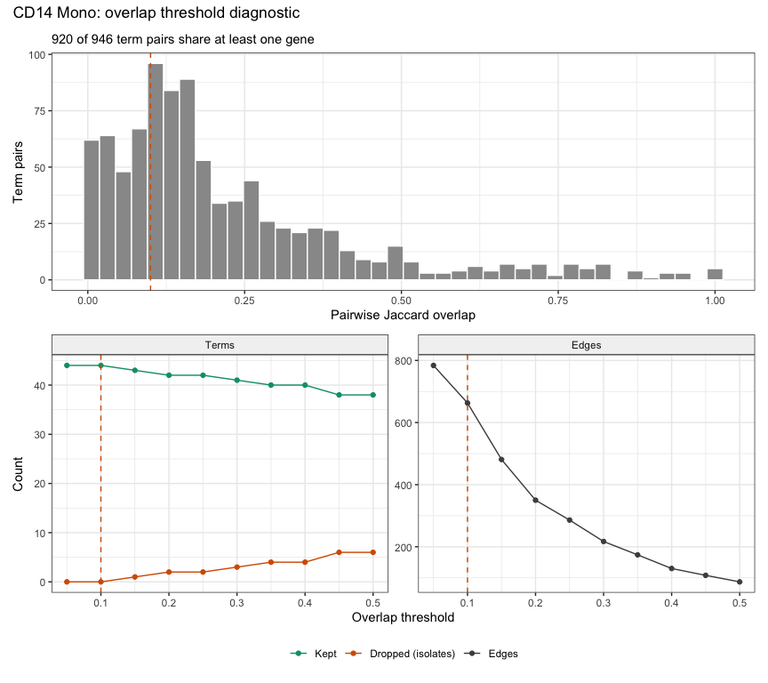
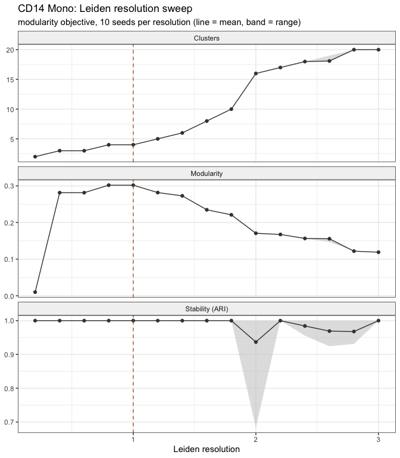
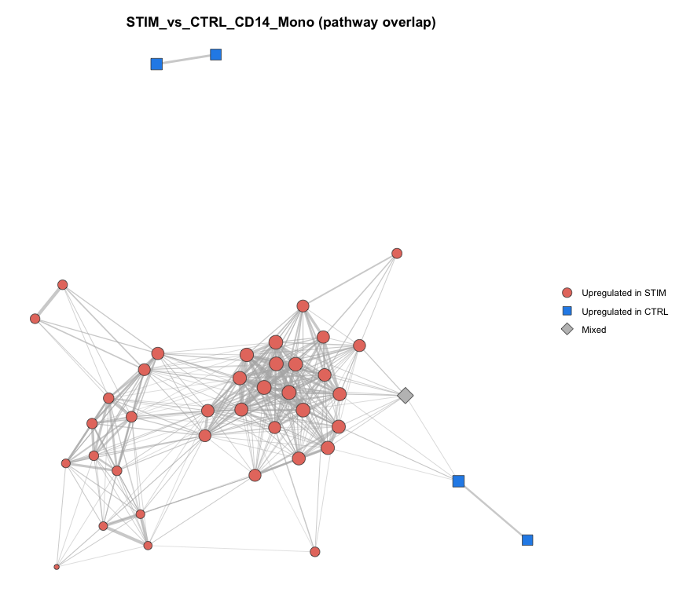
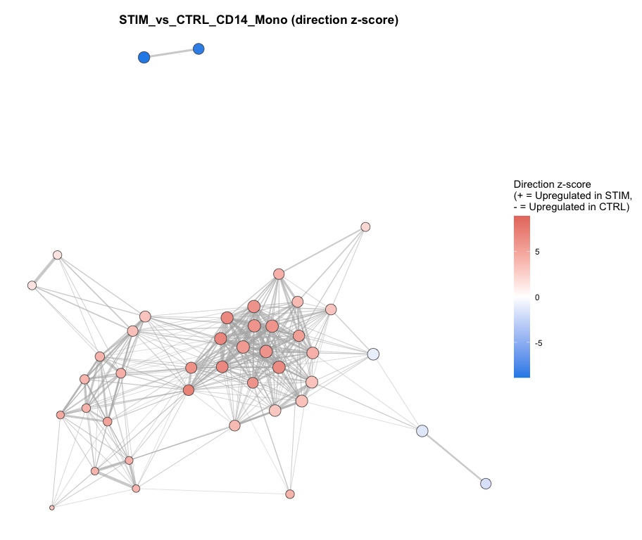
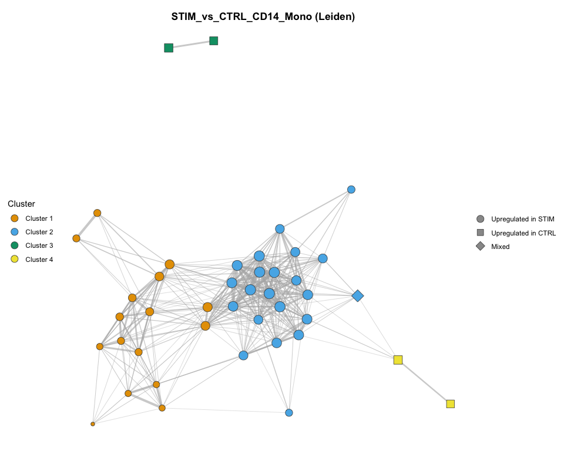
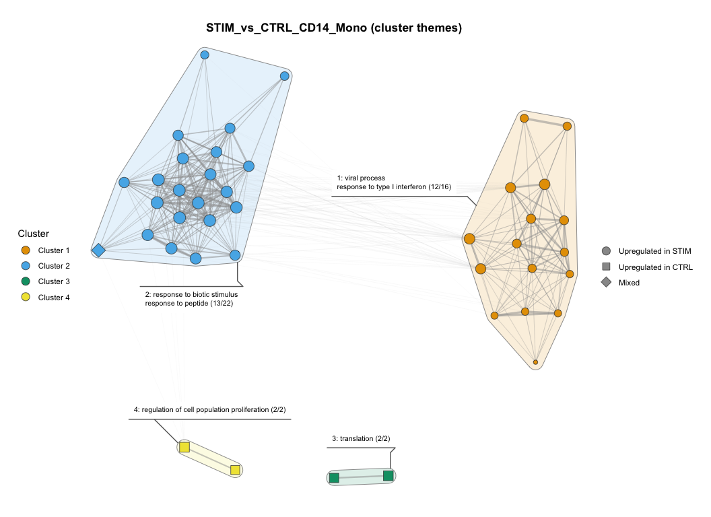
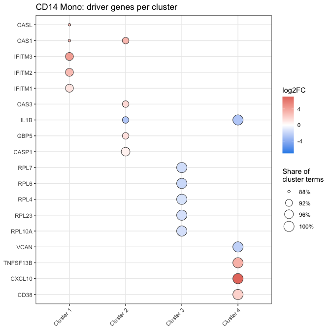
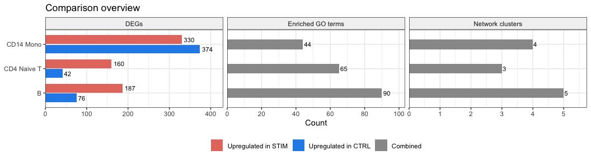
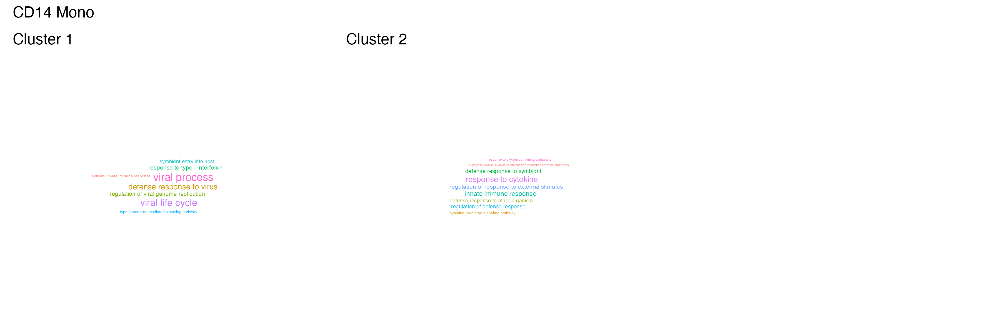
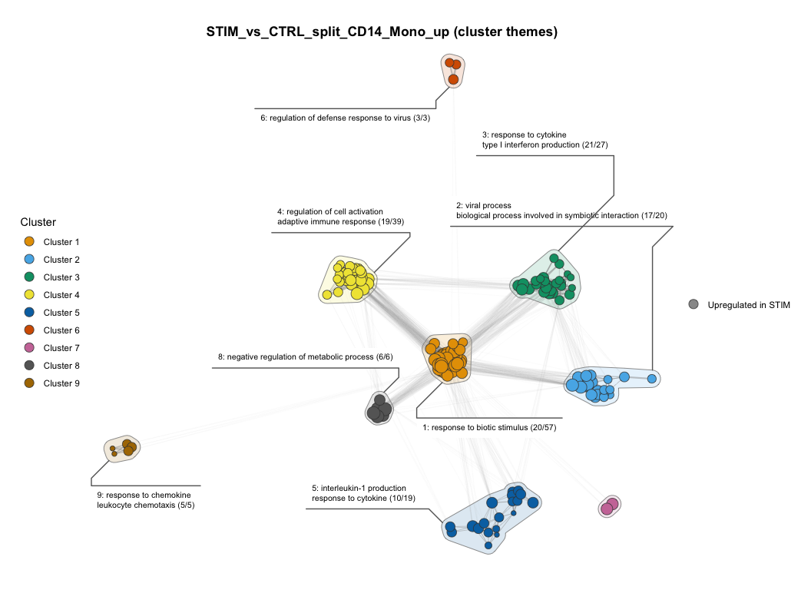

<!--
  This vignette is precomputed. Edit ifnb-example.Rmd.orig, then re-knit from
  the vignettes/ folder with:

    knitr::knit("ifnb-example.Rmd.orig", output = "ifnb-example.Rmd")

  Knitting needs SeuratData with ifnb.SeuratData, org.Hs.eg.db, and the
  current version of scoranet installed.
-->


This vignette runs the full `scoranet` workflow on a real dataset and shows
every kind of output it produces: console summaries, result tables, files
written to disk, network plots, and diagnostic figures.

The data are the interferon-beta stimulated PBMCs from Kang et al. (2018),
*Nature Biotechnology* 36, 89-94, distributed as `ifnb` by the
[SeuratData](https://github.com/satijalab/seurat-data) package. Interferon-beta
triggers a strong, well-characterised antiviral response, which makes it a
good test: the workflow should recover interferon signalling in every cell
type.

# Setup


``` r
library(scoranet)
library(Seurat)
library(SeuratData)
library(org.Hs.eg.db)
```


``` r
data("ifnb")
ifnb <- UpdateSeuratObject(ifnb)
ifnb <- NormalizeData(ifnb, verbose = FALSE)

table(ifnb$seurat_annotations, ifnb$stim)[c("CD14 Mono", "CD4 Naive T", "B"), ]
#>              
#>               CTRL STIM
#>   CD14 Mono   2215 2147
#>   CD4 Naive T  978 1526
#>   B            407  571
```

We compare stimulated (`STIM`) against control (`CTRL`) cells in three cell
types. All output files go to a temporary folder.


``` r
cell_types <- c("CD14 Mono", "CD4 Naive T", "B")
out_dir <- file.path(tempdir(), "ifnb_results")
```

# 1. Differential expression

`run_cluster_de()` runs `Seurat::FindMarkers()` within each cell type and
prints a short summary per cluster.


``` r
de_results <- run_cluster_de(
  obj         = ifnb,
  clusters    = cell_types,
  cluster_col = "seurat_annotations",
  ident_col   = "stim",
  ident1      = "STIM",
  ident2      = "CTRL"
)
#> i Running DE for "CD14 Mono" (STIM vs CTRL)
#> v Running DE for "CD14 Mono" (STIM vs CTRL) [6.1s]
#> 
#> * Tested genes: 1408
#> * DEGs: 704
#> * Up in STIM: 330
#> * Up in CTRL: 374
#> 
#> i Running DE for "CD4 Naive T" (STIM vs CTRL)
#> v Running DE for "CD4 Naive T" (STIM vs CTRL) [884ms]
#> 
#> * Tested genes: 526
#> * DEGs: 202
#> * Up in STIM: 160
#> * Up in CTRL: 42
#> 
#> i Running DE for "B" (STIM vs CTRL)
#> v Running DE for "B" (STIM vs CTRL) [629ms]
#> 
#> * Tested genes: 812
#> * DEGs: 263
#> * Up in STIM: 187
#> * Up in CTRL: 76
#> 
```

Each cell type returns two tables: `degs` (genes passing the adjusted p-value
and fold-change cutoffs) and `tested` (every gene `FindMarkers` tested).


``` r
names(de_results[["CD14 Mono"]])
#> [1] "degs"   "tested"

c(degs = nrow(de_results[["CD14 Mono"]]$degs),
  tested = nrow(de_results[["CD14 Mono"]]$tested))
#>   degs tested 
#>    704   1408
```


``` r
top_degs <- de_results[["CD14 Mono"]]$degs
top_degs <- top_degs[order(-abs(top_degs$avg_log2FC)), ]
knitr::kable(
  head(top_degs[, c("gene", "avg_log2FC", "pct.1", "pct.2", "p_val_adj", "res")], 10),
  digits = 3, row.names = FALSE
)
```


|gene     | avg_log2FC| pct.1| pct.2| p_val_adj|res                 |
|:--------|----------:|-----:|-----:|---------:|:-------------------|
|CCL8     |      7.068| 0.918| 0.017|         0|Upregulated in STIM |
|CXCL10   |      7.014| 0.984| 0.035|         0|Upregulated in STIM |
|ISG15    |      6.342| 1.000| 0.324|         0|Upregulated in STIM |
|APOBEC3B |      5.151| 0.312| 0.039|         0|Upregulated in STIM |
|CXCL11   |      5.087| 0.932| 0.012|         0|Upregulated in STIM |
|TNFSF10  |      4.989| 0.989| 0.047|         0|Upregulated in STIM |
|IFIT3    |      4.976| 0.992| 0.056|         0|Upregulated in STIM |
|IFIT1    |      4.965| 0.985| 0.033|         0|Upregulated in STIM |
|RSAD2    |      4.949| 0.988| 0.045|         0|Upregulated in STIM |
|IFIT2    |      4.765| 0.961| 0.039|         0|Upregulated in STIM |


The strongest changes are classic interferon-stimulated genes and chemokines
(*CCL8*, *CXCL10*, *ISG15*, and the *IFIT* family), exactly what
interferon-beta should induce. CD14 monocytes respond most strongly: about half of their tested genes
are DEGs.

`write_de()` saves both tables per cell type:


``` r
write_de(de_results, outSubDir = paste0(out_dir, "/DE/"))
list.files(file.path(out_dir, "DE"))
#> [1] "B_DE_Results.csv"             "B_tested_genes.csv"          
#> [3] "CD14_Mono_DE_Results.csv"     "CD14_Mono_tested_genes.csv"  
#> [5] "CD4_Naive_T_DE_Results.csv"   "CD4_Naive_T_tested_genes.csv"
```

# 2. GO over-representation analysis

`run_go_ora()` runs `clusterProfiler::enrichGO()` on each cell type's DEGs.
Here each cell type's tested genes are used as its background
(`use_tested_universe = TRUE`), because genes that were never tested could not
have been DEGs.


``` r
go_results <- run_go_ora(
  de_list             = de_results,
  org_db              = org.Hs.eg.db,
  use_tested_universe = TRUE,
  ont                 = "BP",
  outputDir           = paste0(out_dir, "/ORA/")
)
#> 
#> 
#> -- GO set: CD14 Mono --
#> 
#> Genesets tested: 2846
#> After filtering: 44
#> Retention proportion: 0.015
#> 
#> -- GO set: CD4 Naive T --
#> 
#> Genesets tested: 1520
#> After filtering: 65
#> Retention proportion: 0.043
#> 
#> -- GO set: B --
#> 
#> Genesets tested: 1940
#> After filtering: 90
#> Retention proportion: 0.046
```

Each element is a standard `clusterProfiler` `enrichResult`:


``` r
go_cd14 <- as.data.frame(go_results[["CD14 Mono"]])
knitr::kable(
  head(go_cd14[, c("Description", "GeneRatio", "BgRatio", "p.adjust", "Count")], 10),
  digits = 8, row.names = FALSE
)
```


|Description                                                               |GeneRatio |BgRatio  |   p.adjust| Count|
|:-------------------------------------------------------------------------|:---------|:--------|----------:|-----:|
|response to virus                                                         |83/640    |103/1279 | 0.00000007|    83|
|defense response to virus                                                 |68/640    |81/1279  | 0.00000008|    68|
|biological process involved in interspecies interaction between organisms |183/640   |286/1279 | 0.00005110|   183|
|defense response                                                          |182/640   |286/1279 | 0.00008025|   182|
|response to external biotic stimulus                                      |168/640   |262/1279 | 0.00008960|   168|
|response to other organism                                                |168/640   |262/1279 | 0.00008960|   168|
|response to peptide                                                       |124/640   |184/1279 | 0.00008960|   124|
|response to cytokine                                                      |123/640   |183/1279 | 0.00010361|   123|
|defense response to other organism                                        |140/640   |213/1279 | 0.00010361|   140|
|cytoplasmic translation                                                   |73/640    |99/1279  | 0.00014460|    73|


The top terms are antiviral and cytokine responses.

A QC summary of how many gene sets were tested and retained is written for
each run:


``` r
knitr::kable(read.csv(file.path(out_dir, "ORA", "GO_ORA_QC_summary.csv"), row.names = 1))
```


|set         | tested| retained|  prop|
|:-----------|------:|--------:|-----:|
|CD14 Mono   |   2846|       44| 0.015|
|CD4 Naive T |   1520|       65| 0.043|
|B           |   1940|       90| 0.046|


CD14 monocytes have the most DEGs but the fewest enriched terms. With the
tested-gene background, half of their background genes are DEGs, so a term
needs a very large share of DEGs to stand out. This is the tested-gene
universe being appropriately conservative, not a lack of signal.

`write_go()` saves the results, adding numeric gene-ratio columns:


``` r
write_go(go_results, outSubDir = paste0(out_dir, "/ORA/"))
list.files(file.path(out_dir, "ORA"))
#> [1] "B_GO_ORA_Results.csv"           "CD14_Mono_GO_ORA_Results.csv"  
#> [3] "CD4_Naive_T_GO_ORA_Results.csv" "GO_ORA_QC_summary.csv"
```

# 3. Choosing network settings

Before building the final networks, the diagnostics show how the overlap
threshold and Leiden resolution shape them. A first pass at the default
settings is enough to run them (the console summary is hidden here).


``` r
net_default <- run_comparison_networks(
  go_list     = go_results,
  de_list     = de_results,
  comp_label  = "STIM_vs_CTRL",
  base_outdir = paste0(out_dir, "/default/")
)

dx_default <- run_network_diagnostics(net_default, de_results, go_results)
```

## Overlap threshold

Two GO terms are connected when the Jaccard overlap of their DE genes is at
least `overlap_threshold`; terms with no connection are dropped.


``` r
dx_default$networks[["CD14 Mono"]]$overlap_threshold
```

<div class="figure">

<p class="caption">plot of chunk diag-threshold</p>
</div>

Almost every pair of enriched terms shares at least one gene, and many share
only a few. Raising the threshold from the default 0.1 to 0.2 roughly halves
the number of edges while dropping only two terms, so we use 0.2. See
`DIAGNOSTICS.md` in the package repository for a full guide to reading these
figures.

# 4. Pathway overlap networks

We rebuild the networks with the chosen threshold.


``` r
net_results <- run_comparison_networks(
  go_list           = go_results,
  de_list           = de_results,
  comp_label        = "STIM_vs_CTRL",
  base_outdir       = paste0(out_dir, "/"),
  overlap_threshold = 0.2,
  leiden_resolution = 1,
  theme_min_terms   = 2
)
names(net_results)
#> [1] "CD14 Mono"   "CD4 Naive T" "B"
```

## Leiden resolution

With the threshold settled, the resolution sweep checks the clustering:


``` r
dx <- run_network_diagnostics(net_results, de_results, go_results)
dx$networks[["CD14 Mono"]]$leiden_sweep
```

<div class="figure">

<p class="caption">plot of chunk diag-sweep</p>
</div>

A good resolution sits on a plateau where the cluster count is steady,
modularity is high, and stability (agreement between random seeds) is close to
1. Here the default resolution of 1 sits at the modularity peak with perfect
stability, so we keep it. Modularity is modest because nearly every term in
this network is part of one connected interferon response.

If the sweep pointed to a different resolution, `recluster_network()` would
re-run Leiden on the existing network without rebuilding it, keeping the node
layout so plots before and after are directly comparable:


``` r
net_fine <- recluster_network(net_results[["CD14 Mono"]], resolution = 1.5)
net_fine$cluster_stats
#>   cluster avg_degree n_terms
#> 1       1   30.50000       2
#> 2       2   20.85714       7
#> 3       3   20.50000       4
#> 4       4   25.66667       3
#> 5       5    1.00000       2
#> 6       6   13.35714      14
#> 7       7   10.33333       3
#> 8       8   16.28571       7
```

Each network result holds the `igraph` object, tables of terms and clusters,
the settings used, and the node layout. `plot_network()` draws it as one of
four editable `ggplot` objects: `regulation`, `leiden`, `zscore` or `themes`.


``` r
net <- net_results[["CD14 Mono"]]
net
#> <scoranet_network> STIM_vs_CTRL_CD14_Mono
#>   Nodes: 42  Edges: 350  Clusters: 4
#>   Leiden resolution: 1 (modularity)  Overlap threshold: 0.2
#>   Plot with plot_network(); tables with network_tables().
names(net)
#>  [1] "network"            "clustering"         "overlap_matrix"     "go_term_df"        
#>  [5] "cluster_stats"      "leiden_resolution"  "objective_function" "overlap_threshold" 
#>  [9] "seed"               "term_genes"         "cluster_themes"     "cluster_palette"   
#> [13] "layout"             "collection_name"    "ident1"             "ident2"            
#> [17] "file_stem"          "theme_args"
```

## Direction

Nodes are GO terms, coloured by whether their DE genes go up in `STIM` (red),
up in `CTRL` (blue), or both (grey, "mixed"). Edge width shows overlap; node
size shows the number of DE genes in the term. Almost the whole network is
red: stimulation switches on the antiviral program.


``` r
plot_network(net, "regulation")
```

<div class="figure">

<p class="caption">plot of chunk plot-regulation</p>
</div>

The `zscore` plot shows how strongly each term leans one way, on a continuous
scale. The darkest red terms sit at the centre of the antiviral response; the
few blue terms, up in `CTRL`, belong to the small translation and
proliferation clusters.


``` r
plot_network(net, "zscore")
```

<div class="figure">

<p class="caption">plot of chunk plot-zscore</p>
</div>

## Leiden clusters


``` r
plot_network(net, "leiden")
```

<div class="figure">

<p class="caption">plot of chunk plot-leiden</p>
</div>

## Cluster themes

The `themes` plot outlines each Leiden cluster and labels it with the GO terms
its members fall under in the GO hierarchy, with how many of the cluster's
terms they cover. The two large clusters separate the direct antiviral
response (viral process, response to type I interferon) from the broader
immune and cytokine response; the small clusters capture translation
(down in `STIM`) and cell proliferation.


``` r
plot_network(net, "themes", min_terms = 2)
```

<div class="figure">

<p class="caption">plot of chunk plot-themes</p>
</div>

The labels are also available as a table, along with alternative label styles
(`keywords`, `phrase`, `hub`, chosen in the plot with `label_by`):


``` r
knitr::kable(net$cluster_themes[, c("cluster", "n_terms", "ancestor",
                                    "ancestor_n_covered", "hub")])
```


| cluster| n_terms|ancestor                                          | ancestor_n_covered|hub                                         |
|-------:|-------:|:-------------------------------------------------|------------------:|:-------------------------------------------|
|       1|      16|viral process / response to type I interferon     |                 12|defense response to virus                   |
|       2|      22|response to biotic stimulus / response to peptide |                 13|innate immune response                      |
|       3|       2|translation                                       |                  2|cytoplasmic translation                     |
|       4|       2|regulation of cell population proliferation       |                  2|regulation of cell population proliferation |


## Term-level results

`go_term_df` lists every term in the network with its cluster and direction
statistics. It is also saved, with each term's DE genes, as
`<cell type>-cluster-membership.csv`, and the cluster labels as
`<cell type>-cluster-themes.csv`. `network_tables(net)` returns every saved
table in R:


``` r
knitr::kable(
  head(net$go_term_df[order(-net$go_term_df$degree),
                      c("go_term", "cluster", "degree", "regulation",
                        "n_up", "n_down", "zscore", "median_log2FC")], 8),
  digits = 2, row.names = FALSE
)
```


|go_term                                                                   | cluster| degree|regulation | n_up| n_down| zscore| median_log2FC|
|:-------------------------------------------------------------------------|-------:|------:|:----------|----:|------:|------:|-------------:|
|defense response to virus                                                 |       1|     31|up         |   63|      5|   7.03|          1.24|
|response to virus                                                         |       1|     30|up         |   69|     14|   6.04|          1.19|
|innate immune response                                                    |       2|     28|up         |   94|     22|   6.69|          1.00|
|defense response to symbiont                                              |       2|     25|up         |  106|     28|   6.74|          1.00|
|biological process involved in interspecies interaction between organisms |       2|     24|up         |  129|     54|   5.54|          0.84|
|defense response to other organism                                        |       2|     24|up         |  109|     31|   6.59|          1.00|
|immune response                                                           |       2|     24|up         |  129|     44|   6.46|          0.86|
|regulation of response to external stimulus                               |       2|     24|up         |   81|     35|   4.27|          0.80|


# 5. Interpreting modules

## Driver genes

Which genes is each cluster built on?


``` r
dx$networks[["CD14 Mono"]]$driver_genes
```

<div class="figure">

<p class="caption">plot of chunk diag-drivers</p>
</div>

The antiviral cluster is built on the *OAS* and *IFITM* families, the
cytokine cluster on *GBP5*, *CASP1* and *IL1B*, and the translation cluster on
ribosomal protein genes that go down after stimulation.

## Overview across cell types


``` r
dx$overview
```

<div class="figure">

<p class="caption">plot of chunk diag-overview</p>
</div>

CD14 monocytes have by far the most DEGs, split almost evenly between
directions, while the T and B cells respond mostly upward.

## Word clouds

`write_cluster_wordclouds_patchwork()` saves a word cloud of term names for
each cluster:


``` r
write_cluster_wordclouds_patchwork(
  net_list   = net_results["CD14 Mono"],
  outputDir  = paste0(out_dir, "/"),
  comparison = "STIM_vs_CTRL"
)
```


<div class="figure">

<p class="caption">plot of chunk wordclouds-include</p>
</div>

## Terms in one module

`write_cluster_results()` returns every term in the same cluster as a term of
interest. Here, the module containing the most connected term:


``` r
top_term <- net$go_term_df$go_term[which.max(net$go_term_df$degree)]
top_term
#> [1] "defense response to virus"

module <- write_cluster_results(net, go_term = top_term, outdir = NULL)
knitr::kable(head(module[, c("go_term", "cluster", "degree", "regulation")], 10),
             row.names = FALSE)
```


|go_term                                | cluster| degree|regulation |
|:--------------------------------------|-------:|------:|:----------|
|response to virus                      |       1|     30|up         |
|defense response to virus              |       1|     31|up         |
|viral life cycle                       |       1|     20|up         |
|viral process                          |       1|     20|up         |
|regulation of viral process            |       1|     19|up         |
|regulation of viral life cycle         |       1|     18|up         |
|viral genome replication               |       1|     14|up         |
|regulation of viral genome replication |       1|     14|up         |
|antiviral innate immune response       |       1|      7|up         |
|response to type I interferon          |       1|     13|up         |


# 6. Splitting by direction

With `split_direction = TRUE`, ORA runs separately on up- and down-regulated
genes, and a network is built for each direction. This keeps a smaller set of
down-regulated genes from being drowned out by the up-regulated ones.


``` r
go_split <- run_go_ora(
  de_list             = de_results["CD14 Mono"],
  org_db              = org.Hs.eg.db,
  use_tested_universe = TRUE,
  split_direction     = TRUE,
  outputDir           = paste0(out_dir, "/ORA_split/")
)

net_split <- run_comparison_networks(
  go_list           = go_split,
  de_list           = de_results,
  comp_label        = "STIM_vs_CTRL_split",
  base_outdir       = paste0(out_dir, "/"),
  overlap_threshold = 0.2,
  split_direction   = TRUE
)
names(net_split)
#> [1] "CD14 Mono_up"   "CD14 Mono_down"
```


``` r
plot_network(net_split[["CD14 Mono_up"]], "themes")
```

<div class="figure">

<p class="caption">plot of chunk split-up</p>
</div>

Built from the up-regulated genes alone, the CD14 monocyte response resolves
into many distinct modules: type I interferon production, interleukin-1
production, chemokine response and leukocyte chemotaxis, adaptive immune
activation, and more. In the combined network these were merged into two
large clusters.

# 7. Files written

Everything the workflow saved to disk:


``` r
files <- list.files(out_dir, recursive = TRUE)
files[!grepl("^default/", files)]
#>  [1] "DE/B_DE_Results.csv"                                              
#>  [2] "DE/B_tested_genes.csv"                                            
#>  [3] "DE/CD14_Mono_DE_Results.csv"                                      
#>  [4] "DE/CD14_Mono_tested_genes.csv"                                    
#>  [5] "DE/CD4_Naive_T_DE_Results.csv"                                    
#>  [6] "DE/CD4_Naive_T_tested_genes.csv"                                  
#>  [7] "ORA/B_GO_ORA_Results.csv"                                         
#>  [8] "ORA/CD14_Mono_GO_ORA_Results.csv"                                 
#>  [9] "ORA/CD4_Naive_T_GO_ORA_Results.csv"                               
#> [10] "ORA/GO_ORA_QC_summary.csv"                                        
#> [11] "ORA_split/GO_ORA_QC_summary.csv"                                  
#> [12] "STIM_vs_CTRL/networks/B-cluster-membership.csv"                   
#> [13] "STIM_vs_CTRL/networks/B-cluster-stats.csv"                        
#> [14] "STIM_vs_CTRL/networks/B-cluster-themes.csv"                       
#> [15] "STIM_vs_CTRL/networks/B-clustered-leiden.png"                     
#> [16] "STIM_vs_CTRL/networks/B-regulation.png"                           
#> [17] "STIM_vs_CTRL/networks/B-themes.png"                               
#> [18] "STIM_vs_CTRL/networks/B-zscore.png"                               
#> [19] "STIM_vs_CTRL/networks/B_network_summary.csv"                      
#> [20] "STIM_vs_CTRL/networks/CD14_Mono-cluster-membership.csv"           
#> [21] "STIM_vs_CTRL/networks/CD14_Mono-cluster-stats.csv"                
#> [22] "STIM_vs_CTRL/networks/CD14_Mono-cluster-themes.csv"               
#> [23] "STIM_vs_CTRL/networks/CD14_Mono-clustered-leiden.png"             
#> [24] "STIM_vs_CTRL/networks/CD14_Mono-regulation.png"                   
#> [25] "STIM_vs_CTRL/networks/CD14_Mono-themes.png"                       
#> [26] "STIM_vs_CTRL/networks/CD14_Mono-zscore.png"                       
#> [27] "STIM_vs_CTRL/networks/CD14_Mono_all_clusters_wordclouds.png"      
#> [28] "STIM_vs_CTRL/networks/CD14_Mono_network_summary.csv"              
#> [29] "STIM_vs_CTRL/networks/CD4_Naive_T-cluster-membership.csv"         
#> [30] "STIM_vs_CTRL/networks/CD4_Naive_T-cluster-stats.csv"              
#> [31] "STIM_vs_CTRL/networks/CD4_Naive_T-cluster-themes.csv"             
#> [32] "STIM_vs_CTRL/networks/CD4_Naive_T-clustered-leiden.png"           
#> [33] "STIM_vs_CTRL/networks/CD4_Naive_T-regulation.png"                 
#> [34] "STIM_vs_CTRL/networks/CD4_Naive_T-themes.png"                     
#> [35] "STIM_vs_CTRL/networks/CD4_Naive_T-zscore.png"                     
#> [36] "STIM_vs_CTRL/networks/CD4_Naive_T_network_summary.csv"            
#> [37] "STIM_vs_CTRL_split/networks/CD14_Mono_down-cluster-membership.csv"
#> [38] "STIM_vs_CTRL_split/networks/CD14_Mono_down-cluster-stats.csv"     
#> [39] "STIM_vs_CTRL_split/networks/CD14_Mono_down-cluster-themes.csv"    
#> [40] "STIM_vs_CTRL_split/networks/CD14_Mono_down-clustered-leiden.png"  
#> [41] "STIM_vs_CTRL_split/networks/CD14_Mono_down-regulation.png"        
#> [42] "STIM_vs_CTRL_split/networks/CD14_Mono_down-themes.png"            
#> [43] "STIM_vs_CTRL_split/networks/CD14_Mono_down-zscore.png"            
#> [44] "STIM_vs_CTRL_split/networks/CD14_Mono_down_network_summary.csv"   
#> [45] "STIM_vs_CTRL_split/networks/CD14_Mono_up-cluster-membership.csv"  
#> [46] "STIM_vs_CTRL_split/networks/CD14_Mono_up-cluster-stats.csv"       
#> [47] "STIM_vs_CTRL_split/networks/CD14_Mono_up-cluster-themes.csv"      
#> [48] "STIM_vs_CTRL_split/networks/CD14_Mono_up-clustered-leiden.png"    
#> [49] "STIM_vs_CTRL_split/networks/CD14_Mono_up-regulation.png"          
#> [50] "STIM_vs_CTRL_split/networks/CD14_Mono_up-themes.png"              
#> [51] "STIM_vs_CTRL_split/networks/CD14_Mono_up-zscore.png"              
#> [52] "STIM_vs_CTRL_split/networks/CD14_Mono_up_network_summary.csv"
```

# Session information


``` r
sessionInfo()
#> R version 4.4.1 (2024-06-14)
#> Platform: aarch64-apple-darwin20
#> Running under: macOS Sonoma 14.6
#> 
#> Matrix products: default
#> BLAS:   /Library/Frameworks/R.framework/Versions/4.4-arm64/Resources/lib/libRblas.0.dylib 
#> LAPACK: /Library/Frameworks/R.framework/Versions/4.4-arm64/Resources/lib/libRlapack.dylib;  LAPACK version 3.12.0
#> 
#> locale:
#> [1] C
#> 
#> time zone: America/New_York
#> tzcode source: internal
#> 
#> attached base packages:
#> [1] stats4    stats     graphics  grDevices utils     datasets  methods   base     
#> 
#> other attached packages:
#>  [1] org.Hs.eg.db_3.20.0     AnnotationDbi_1.68.0    IRanges_2.40.1         
#>  [4] S4Vectors_0.44.0        Biobase_2.66.0          BiocGenerics_0.52.0    
#>  [7] pbmc3k.SeuratData_3.1.4 ifnb.SeuratData_3.1.0   SeuratData_0.2.1       
#> [10] SeuratObject_4.1.4      Seurat_4.4.0            scoranet_1.0.0         
#> 
#> loaded via a namespace (and not attached):
#>   [1] RcppAnnoy_0.0.22        splines_4.4.1           later_1.4.4            
#>   [4] ggplotify_0.1.2         tibble_3.3.0            R.oo_1.27.1            
#>   [7] polyclip_1.10-7         lifecycle_1.0.4         globals_0.18.0         
#>  [10] lattice_0.22-7          MASS_7.3-65             magrittr_2.0.4         
#>  [13] limma_3.60.6            plotly_4.11.0           httpuv_1.6.16          
#>  [16] sctransform_0.4.2       sp_2.2-0                spatstat.sparse_3.1-0  
#>  [19] reticulate_1.43.0       cowplot_1.2.0           pbapply_1.7-4          
#>  [22] DBI_1.2.3               RColorBrewer_1.1-3      abind_1.4-8            
#>  [25] zlibbioc_1.52.0         Rtsne_0.17              purrr_1.1.0            
#>  [28] R.utils_2.13.0          ggraph_2.2.2            yulab.utils_0.2.0      
#>  [31] tweenr_2.0.3            rappdirs_0.3.3          GenomeInfoDbData_1.2.13
#>  [34] enrichplot_1.24.4       ggrepel_0.9.6           irlba_2.3.5.1          
#>  [37] listenv_0.9.1           spatstat.utils_3.1-5    tidytree_0.4.6         
#>  [40] goftest_1.2-3           spatstat.random_3.4-1   fitdistrplus_1.2-4     
#>  [43] parallelly_1.45.1       commonmark_2.0.0        ggwordcloud_0.6.2      
#>  [46] leiden_0.4.3.1          codetools_0.2-20        DOSE_4.0.1             
#>  [49] xml2_1.4.0              ggforce_0.5.0           tidyselect_1.2.1       
#>  [52] aplot_0.2.8             UCSC.utils_1.2.0        farver_2.1.2           
#>  [55] viridis_0.6.5           matrixStats_1.5.0       spatstat.explore_3.5-2 
#>  [58] jsonlite_2.0.0          tidygraph_1.3.1         progressr_0.15.1       
#>  [61] ggridges_0.5.7          survival_3.8-3          systemfonts_1.3.1      
#>  [64] tools_4.4.1             ragg_1.5.0              treeio_1.28.0          
#>  [67] ica_1.0-3               Rcpp_1.1.0              glue_1.8.0             
#>  [70] gridExtra_2.3           xfun_0.53               qvalue_2.36.0          
#>  [73] GenomeInfoDb_1.42.3     dplyr_1.1.4             withr_3.0.2            
#>  [76] fastmap_1.2.0           litedown_0.7            digest_0.6.37          
#>  [79] gridGraphics_0.5-1      R6_2.6.1                mime_0.13              
#>  [82] textshaping_1.0.3       colorspace_2.1-1        scattermore_1.2        
#>  [85] GO.db_3.20.0            tensor_1.5.1            markdown_2.0           
#>  [88] dichromat_2.0-0.1       spatstat.data_3.1-8     RSQLite_2.4.2          
#>  [91] R.methodsS3_1.8.2       tidyr_1.3.1             generics_0.1.4         
#>  [94] data.table_1.17.8       graphlayouts_1.2.2      httr_1.4.7             
#>  [97] htmlwidgets_1.6.4       scatterpie_0.2.5        uwot_0.2.3             
#> [100] pkgconfig_2.0.3         gtable_0.3.6            blob_1.2.4             
#> [103] lmtest_0.9-40           S7_0.2.0                XVector_0.46.0         
#> [106] shadowtext_0.1.5        clusterProfiler_4.14.6  htmltools_0.5.8.1      
#> [109] fgsea_1.30.0            scales_1.4.0            png_0.1-8              
#> [112] spatstat.univar_3.1-4   ggfun_0.2.0             knitr_1.50             
#> [115] reshape2_1.4.4          nlme_3.1-168            zoo_1.8-14             
#> [118] cachem_1.1.0            stringr_1.5.2           KernSmooth_2.23-26     
#> [121] parallel_4.4.1          miniUI_0.1.2            pillar_1.11.1          
#> [124] grid_4.4.1              vctrs_0.6.5             RANN_2.6.2             
#> [127] promises_1.3.3          xtable_1.8-4            cluster_2.1.8.1        
#> [130] evaluate_1.0.5          cli_3.6.5               compiler_4.4.1         
#> [133] rlang_1.1.6             crayon_1.5.3            future.apply_1.11.2    
#> [136] labeling_0.4.3          plyr_1.8.9              fs_1.6.6               
#> [139] stringi_1.8.7           viridisLite_0.4.2       deldir_2.0-4           
#> [142] BiocParallel_1.40.2     Biostrings_2.74.1       lazyeval_0.2.2         
#> [145] spatstat.geom_3.5-0     GOSemSim_2.32.0         Matrix_1.7-3           
#> [148] patchwork_1.3.2         bit64_4.6.0-1           future_1.33.2          
#> [151] ggplot2_4.0.0           KEGGREST_1.44.1         statmod_1.5.0          
#> [154] shiny_1.11.1            ROCR_1.0-11             gridtext_0.1.5         
#> [157] igraph_2.1.4            memoise_2.0.1           ggtree_3.12.0          
#> [160] fastmatch_1.1-6         bit_4.6.0               gson_0.1.0             
#> [163] ape_5.8-1
```
